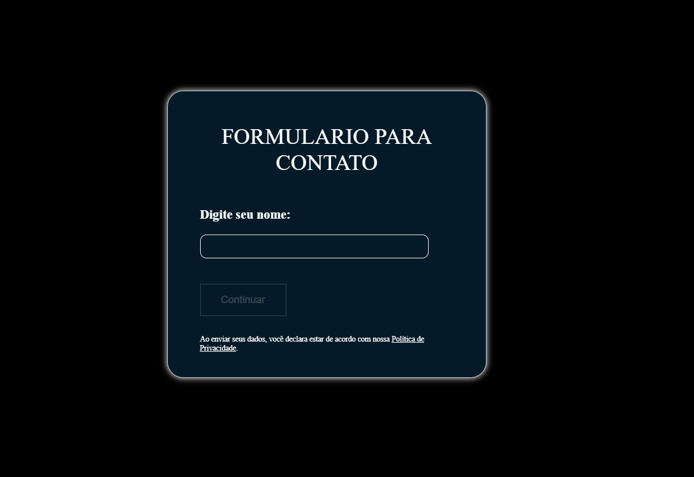

# Formulário de Contato

Um protótipo front-end de formulário de contato dividido em etapas. A interface reúne campos para nome, WhatsApp e e-mail, além de uma tela de confirmação e uma camada visual de carregamento.

## Demonstração

[](https://gabrielmatheus1.github.io/Formulario-De-Contato/)



## Estrutura do formulário

A interface está organizada em quatro etapas:

1. Preenchimento do nome
2. Preenchimento do WhatsApp
3. Preenchimento do e-mail e aceite dos termos
4. Mensagem de confirmação do contato

## Recursos visuais

- Formulário organizado em blocos independentes
- Botões para avançar e voltar entre as etapas
- Estilos específicos para botões desabilitados
- Animação de carregamento com `@keyframes`
- Efeitos de interação nos botões
- Tela final de confirmação
- Layout centralizado com identidade visual escura

## Tecnologias

- HTML5
- CSS3
- Animações com `@keyframes`
- SheetDB configurado no atributo `action` do formulário

## Como funciona

As etapas usam a classe `.step` e ficam ocultas por padrão. A classe `.active` identifica a etapa visível, começando pelo campo de nome. O HTML também contém as demais etapas, a tela de carregamento e a mensagem final.

O formulário está configurado com um endpoint do SheetDB e o método `POST`:

```html
<form id="form" action="https://sheetdb.io/api/v1/uvlkbzlcj05oj" method="post">
```

## Estado atual

A versão atual contém a estrutura visual completa. A navegação entre etapas, as validações e o controle do envio dependem de JavaScript, que não está presente no código atual.

## Estrutura do projeto

```text
Formulario-De-Contato/
├── index.html
├── src/
│   ├── css/
│   │   ├── estilo.css
│   │   └── reset.css
│   └── img/
│       ├── icon.png
│       └── preview.png
└── README.md
```

## Aprendizados

Este projeto foi desenvolvido para praticar:

- Estruturação de formulários em etapas
- Organização de componentes com classes CSS
- Estados visuais de campos e botões
- Animações com CSS
- Configuração de um formulário para envio por API

## Autor

Desenvolvido por [Gabriel Izidoro](https://github.com/GabrielMatheus1).
